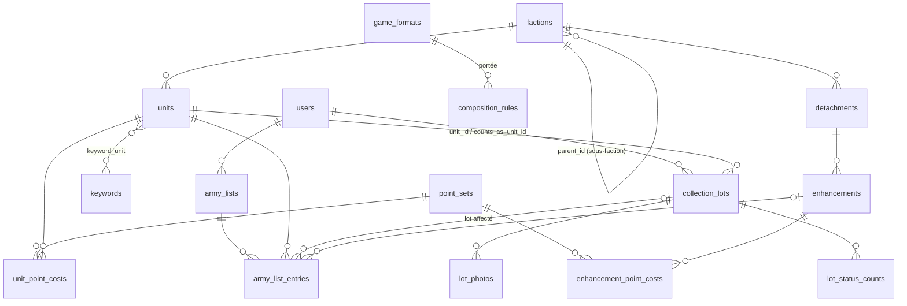

# W40k Collection — Gestion d'armées et de collection Warhammer 40 000

## 1. Présentation

Application web personnelle pour gérer une collection de figurines Warhammer 40 000
et construire des listes d'armée à partir de cette collection.

**Objectifs**
- Suivre la collection : unités possédées, quantités, état d'avancement (montage, peinture), photos, notes.
- Visualiser la progression de peinture par faction (en % et en points).
- Construire des listes d'armée avec calcul automatique des points et validation des règles de composition.
- Savoir si une liste est jouable avec la collection réelle, et sinon ce qu'il manque.
- Plus tard : suivi des parties et statistiques, import des catalogues BSData, multi-utilisateur.

**Périmètre**
- Mono-utilisateur au départ, architecture prête pour plusieurs comptes.
- Interface en français ; données de référence (noms d'unités, mots-clés) en anglais, avec traduction française.
- Saisie manuelle des données dès le départ ; import BSData optionnel en phase ultérieure.

## 2. Prérequis et installation

### Prérequis
- Windows 11 + [Laragon](https://laragon.org/) avec :
  - PHP ≥ 8.3 (testé avec 8.3.30)
  - MySQL 8 (ou MariaDB ≥ 10.6)
  - Node.js ≥ 20 et npm
  - Composer
- Git

### Installation sur une machine Laragon vierge
Depuis le terminal Laragon (bouton « Terminal ») :

```bash
cd C:\laragon\www
git clone https://github.com/krishn4k/w40k.git w40k
cd w40k
composer install
copy .env.example .env
php artisan key:generate
npm ci
```

> `npm ci` installe exactement les versions de `package-lock.json` sans le modifier.
> Réserver `npm install <paquet>` à l'ajout d'une dépendance.

Créer les bases de données (MySQL de Laragon démarré) : `w40k` pour l'application,
`w40k_testing` pour les tests :

```bash
mysql -u root -e "CREATE DATABASE w40k CHARACTER SET utf8mb4 COLLATE utf8mb4_unicode_ci;"
mysql -u root -e "CREATE DATABASE w40k_testing CHARACTER SET utf8mb4 COLLATE utf8mb4_unicode_ci;"
php artisan migrate
npm run build
```

Puis dans Laragon : menu → Apache → Recharger (création du virtual host automatique),
et ouvrir http://w40k.test

> Au premier lancement, démarrer Laragon **en administrateur** (clic droit → Exécuter en tant
> qu'administrateur) : il doit écrire `w40k.test` dans le fichier `hosts` de Windows. Si le site est
> introuvable, recharger Apache dans ce mode. Si le `DocumentRoot` du fichier
> `C:\laragon\etc\apache2\sites-enabled\auto.w40k.test.conf` ne se termine pas par `/public`,
> supprimer ce fichier et recharger Apache.
>
> `http://localhost:5173` (ouvert par `npm run dev`) n'est que le serveur d'assets Vite,
> pas l'application.

En développement, lancer `npm run dev` pour le rechargement à chaud des assets.

## 3. Stack et choix techniques

| Élément | Choix | Raison |
|---|---|---|
| Framework | Laravel 13 | Dernière version stable, écosystème complet (ORM, migrations, validation, auth à venir). |
| PHP | 8.3 | Minimum requis par Laravel 13, disponible dans Laragon. |
| Base de données | MySQL | Fourni par Laragon, adapté au relationnel. |
| Templates | Blade, layouts via `@extends` / `@section` | Rendu serveur simple, héritage de layouts explicite. Pas de composants Blade pour les layouts. |
| CSS | Tailwind CSS 4 via Vite | Inclus par défaut dans Laravel 13, styles utilitaires sans CSS sur mesure. |
| JS | Alpine.js 3 (npm, bundlé par Vite) | Interactivité légère (formulaires dynamiques, calcul de points en direct) sans SPA. |
| Police | Instrument Sans via Fontsource (npm) | Police auto-hébergée, build reproductible sans accès réseau, aucune requête externe à l'exécution. |
| Assistance IA | Laravel Boost (dev) | Consignes et skills adaptées aux versions installées, serveur MCP (docs, schéma BDD) pour l'assistant de code. |
| Environnement | Laragon | Environnement local Windows tout-en-un, virtual hosts automatiques (`w40k.test`). |

## 4. Modèle de données

Schéma validé le 2026-10-17 (Phase 1). Les migrations suivent ce schéma.



### Référentiel partagé (sans `user_id`)

| Table | Colonnes clés |
|---|---|
| `factions` | `parent_id` (nullable : sous-faction), `slug`, `name` |
| `detachments` | `faction_id`, `name` |
| `units` | `faction_id`, `name`, `role` (Character, Battleline…), `is_epic_hero` |
| `keywords` + `keyword_unit` | Mots-clés (Infantry, Terminator…), table pivot |
| `point_sets` | `name` (ex. « MFM 2026 v1 »), `valid_from`, `valid_to` |
| `unit_point_costs` | `unit_id`, `point_set_id`, `model_count`, `points` (un palier par ligne) |
| `enhancements` | `detachment_id`, `name` |
| `enhancement_point_costs` | `enhancement_id`, `point_set_id`, `points` |
| `game_formats` | `name` (Incursion, Strike Force, Onslaught), `points_limit` |
| `composition_rules` | `scope_type` + `scope_id` (format, faction, détachement), `rule_type`, `parameters` (JSON), `message` |

Les colonnes `name` du référentiel sont en JSON : `{"en": "...", "fr": "..."}`.
L'anglais est la langue de référence, et une autre langue s'ajoute sans migration.

### Données personnelles (avec `user_id`)

| Table | Colonnes clés |
|---|---|
| `users` | Colonnes Laravel + `playable_min_status` (`assembled` par défaut) |
| `collection_lots` | `user_id`, `unit_id`, `counts_as_unit_id` (proxy, nullable), `label`, `quantity`, `notes` |
| `lot_status_counts` | `collection_lot_id`, `status`, `count` (somme des `count` = `quantity`) |
| `lot_photos` | `collection_lot_id`, `path`, `caption`, `position` |
| `army_lists` | `user_id`, `name`, `faction_id`, `detachment_id`, `game_format_id`, `point_set_id` (nullable = version en vigueur) |
| `army_list_entries` | `army_list_id`, `unit_id`, `model_count`, `collection_lot_id` (nullable, unique par liste), `enhancement_id`, `is_warlord`, `position` |

Statuts de peinture, dans l'ordre :

| Valeur | Libellé |
|---|---|
| `on_sprue` | Sur grappe |
| `assembled` | Monté |
| `primed` | Sous-couché |
| `painted` | Peint |
| `finished` | Terminé (soclage, vernis) |

**Hors périmètre pour l'instant** : options d'équipement, rattachement Leader/Bodyguard, parties (Phase 4).

### Principes retenus

- **Référentiel partagé** (factions, sous-factions, détachements, unités, coûts en points, contraintes)
  séparé des **données personnelles** (collection, listes, parties) rattachées à un utilisateur.
- **Hiérarchie faction → sous-faction**, la sous-faction héritant des unités de sa faction mère.
- **Coûts en points versionnés** (édition / dataslate, date de validité), par palier de taille d'escouade.
- **Aucun total stocké dans une liste** : toujours recalculé.
- **Collection par lots** : une ligne = un groupe de figurines d'une même unité, avec quantité ajustable
  (ex. figurine perdue : 10 → 9) et répartition par statut de peinture.
- **Jouabilité par lot physique** : un lot ne peut être affecté qu'une fois dans une même liste,
  mais peut servir dans plusieurs listes. Deux lots de 5 Terminators = deux unités jouables.
- **Seuil de jouabilité réglable** (statut minimal pour qu'une figurine compte, « monté » par défaut).
- **Proxys / kitbash** prévus dans le modèle (un lot peut compter comme une autre unité).
- **Contraintes de composition génériques**, saisies à la main, et alimentées plus tard par BSData.

## 5. Feuille de route

### Phase 0 : Initialisation
- [x] Création du projet Laravel et configuration Laragon
- [x] Base de données et .env
- [x] Tailwind et Alpine via Vite
- [x] Layout principal Blade
- [x] README initial
- [x] Initialisation Git et premier commit

### Phase 1 : Conception
- [x] Modèle de données complet, présenté sous forme de schéma avant toute migration
- [x] Validation du schéma
- [ ] Migrations, modèles Eloquent et relations
- [ ] Seeders avec une faction de test

### Phase 2 : Collection
- [ ] CRUD factions et unités (avec traduction FR)
- [ ] CRUD figurines possédées (lots, quantités, statuts)
- [ ] Upload de photos
- [ ] Tableau de bord de progression

### Phase 3 : Listes d'armée
- [ ] Création et édition de listes (format, faction, détachement)
- [ ] Calcul des points
- [ ] Validation des règles de composition (moteur générique, contraintes saisies à la main)
- [ ] Vérification de jouabilité par rapport à la collection
- [ ] Duplication et export texte

### Phase 4 : Parties et statistiques
### Phase 5 : Import BSData (alimentation du référentiel et des contraintes)
### Phase 6 : Authentification multi-utilisateur
### Phase ultérieure : Localisation (autres langues que FR/EN)

## 6. Journal des décisions

| Date | Décision | Raison |
|---|---|---|
| 2026-10-03 | Laravel 13 / PHP 8.3 | Dernière version stable ; PHP 8.3.30 disponible dans Laragon. |
| 2026-10-03 | Code généré et testé dans un environnement distant, récupéré par `git pull` | Permet de tester avant de pousser ; le README garde les commandes d'installation locale. |
| 2026-10-17 | Fin de la Phase 0 : développement désormais en local (`C:\laragon\www\w40k`), push Git en fin de session | Travail direct dans l'environnement réel (Laragon, MySQL) ; remplace le développement distant. |
| 2026-10-17 | `npm ci` pour installer les dépendances JS | Évite les modifications locales de `package-lock.json` qui bloquent `git pull`. |
| 2026-10-03 | Collection par lots avec quantité ajustable | Saisie rapide, tout en gérant pertes et répartition par statut. |
| 2026-10-03 | Validation complète des règles via un moteur de contraintes générique | Validation complète demandée, sans dépendance du cœur à BSData. |
| 2026-10-03 | Données de référence en anglais, traduction FR en v1, interface FR | Compatibilité avec BSData (anglais) ; localisation extensible. |
| 2026-10-03 | Jouabilité calculée par lot physique, seuil de statut réglable | Une figurine physique ne compte qu'une fois par liste. |
| 2026-10-03 | Tests MySQL via MariaDB 10.11 dans l'environnement distant | Valider les migrations sur un moteur compatible MySQL avant chaque push. |
| 2026-10-17 | MySQL utf8mb4_unicode_ci, fuseau UTC, locale fr (repli en) | Support complet des caractères ; dates stockées en UTC et converties à l'affichage. |
| 2026-10-17 | `package-lock.json` versionné | Installations npm reproductibles d'une machine à l'autre. |
| 2026-10-17 | Laravel Boost installé (dev), agent Claude Code, sans Laravel Cloud | Suivre les conventions Laravel à jour ; projet local sous Laragon, pas de déploiement Cloud. |
| 2026-10-17 | `AGENTS.md` supprimé, `boost:update` lancé après chaque `composer update` | Seul Claude Code est utilisé ; consignes Boost toujours synchronisées avec les dépendances. |
| 2026-10-17 | Protocole de travail ajouté en tête de `CLAUDE.md` | Appliqué automatiquement par les futures sessions de l'assistant ; préservé par `boost:update`. |
| 2026-10-17 | Alpine.js installé via npm et bundlé par Vite (pas de CDN) | Version figée dans `package-lock.json`, un seul bundle JS, fonctionne hors ligne. |
| 2026-10-17 | Police via Fontsource au lieu de Bunny Fonts | Build sans réseau et testable partout ; police servie depuis l'application. |
| 2026-10-17 | Layout unique `layouts/app` : barre de navigation en haut, menu mobile Alpine | Navigation simple ; liens grisés « bientôt » tant que les pages n'existent pas. |
| 2026-10-17 | Thème clair/sombre automatique (`prefers-color-scheme`, variantes `dark:` de Tailwind) | Suit le réglage du système, sans JS ni préférence à stocker. |
| 2026-10-17 | Traductions du référentiel en colonnes JSON (`{"en", "fr"}`), cast maison | Aucune dépendance ; nouvelle langue sans migration ; anglais = clé de rapprochement avec BSData. |
| 2026-10-17 | Répartition par statut dans une table `lot_status_counts` | Un statut s'ajoute sans migration ; la somme est contrôlée en code. |
| 2026-10-17 | 5 statuts de peinture : sur grappe, monté, sous-couché, peint, terminé | Granularité suffisante pour la progression ; « monté » sert de seuil de jouabilité par défaut. |
| 2026-10-17 | Tests sur une base MySQL dédiée `w40k_testing` (au lieu de SQLite en mémoire) | Même moteur qu'en développement : JSON, clés étrangères et index uniques testés en conditions réelles. |

## 7. Problèmes connus et points en attente

- Moteur de contraintes : périmètre exact des règles couvertes à définir en Phase 1/3.
- Proxys / kitbash : prévus dans le modèle, interface à définir.
- Fichiers de traduction Laravel en français (messages de validation, pagination)
  à ajouter avec la première interface (Phase 2) ; d'ici là, repli sur l'anglais.
