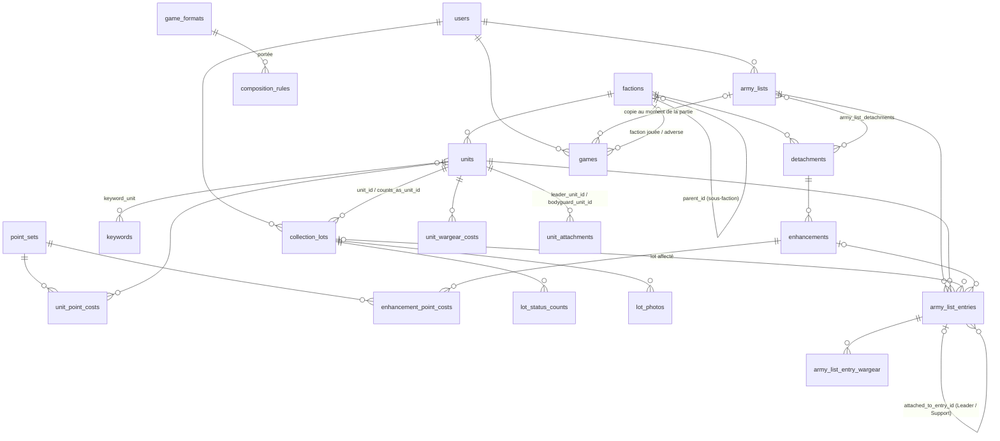

# W40k Collection — Gestion d'armées et de collection Warhammer 40 000

## 1. Présentation

Application web personnelle pour gérer une collection de figurines Warhammer 40 000
et construire des listes d'armée à partir de cette collection.

**Objectifs**
- Suivre la collection : unités possédées, quantités, état d'avancement (montage, peinture), photos, notes.
- Visualiser la progression de peinture par faction (en % et en points).
- Construire des listes d'armée avec calcul automatique des points et validation des règles de composition.
- Savoir si une liste est jouable avec la collection réelle, et sinon ce qu'il manque.
- Plus tard : suivi des parties et statistiques, import des catalogues BSData, multi-utilisateur.

**Périmètre**
- Mono-utilisateur au départ, architecture prête pour plusieurs comptes.
- Interface en français ; données de référence (noms d'unités, mots-clés) en anglais, avec traduction française.
- Saisie manuelle des données dès le départ ; import BSData optionnel en phase ultérieure.

## 2. Prérequis et installation

### Prérequis
- Windows 11 + [Laragon](https://laragon.org/) avec :
  - PHP ≥ 8.3 (testé avec 8.3.30)
  - MySQL 8 (ou MariaDB ≥ 10.6)
  - Node.js ≥ 20 et npm
  - Composer
- Git

### Installation sur une machine Laragon vierge
Depuis le terminal Laragon (bouton « Terminal ») :

```bash
cd C:\laragon\www
git clone https://github.com/krishn4k/w40k.git w40k
cd w40k
composer install
copy .env.example .env
php artisan key:generate
npm ci
```

> `npm ci` installe exactement les versions de `package-lock.json` sans le modifier.
> Réserver `npm install <paquet>` à l'ajout d'une dépendance.

Créer les bases de données (MySQL de Laragon démarré) : `w40k` pour l'application,
`w40k_testing` pour les tests :

```bash
mysql -u root -e "CREATE DATABASE w40k CHARACTER SET utf8mb4 COLLATE utf8mb4_unicode_ci;"
mysql -u root -e "CREATE DATABASE w40k_testing CHARACTER SET utf8mb4 COLLATE utf8mb4_unicode_ci;"
php artisan migrate --seed
php artisan bsdata:import
npm run build
```

> `--seed` charge les formats de jeu, leurs règles de composition et un utilisateur `test@example.com`
> (mot de passe `password`).
> `bsdata:import` télécharge les catalogues BSData (≈ 36 Mo, dans `storage/app/bsdata`, non versionné) et
> importe factions, unités, points, détachements et optimisations (≈ 30 s). Il télécharge ensuite le
> Munitorum Field Manual (YAML de `BSData/wh40k-11e-mfm`, dans `storage/app/mfm`) et applique les points
> officiels V11 : paliers par rang d'exemplaire, coûts d'équipement, DP et tags « Unique » des détachements,
> Upgrades, rattachements Leader / Support (`--without-mfm` pour s'en passer, `-v` pour le détail des
> unités non trouvées). À relancer à chaque mise à jour BSData ou MFM ; `--offline` réutilise les fichiers
> déjà téléchargés. Il applique ensuite les noms français de
> `database/translations/fr.csv` (voir « Traductions » ci-dessous).
> Créer son propre compte administrateur : `php artisan app:create-user --admin`. Les joueurs suivants
> s'inscrivent par un lien d'invitation créé dans Administration (pas d'inscription publique).
> Lancer les tests : `php artisan test --compact` (ils utilisent `w40k_testing`, jamais `w40k`).

Puis dans Laragon : menu → Apache → Recharger (création du virtual host automatique),
et ouvrir http://w40k.test

> Au premier lancement, démarrer Laragon **en administrateur** (clic droit → Exécuter en tant
> qu'administrateur) : il doit écrire `w40k.test` dans le fichier `hosts` de Windows. Si le site est
> introuvable, recharger Apache dans ce mode. Si le `DocumentRoot` du fichier
> `C:\laragon\etc\apache2\sites-enabled\auto.w40k.test.conf` ne se termine pas par `/public`,
> supprimer ce fichier et recharger Apache.
>
> `http://localhost:5173` (ouvert par `npm run dev`) n'est que le serveur d'assets Vite,
> pas l'application.

En développement, lancer `npm run dev` pour le rechargement à chaud des assets.

### Mise en ligne : krishnak.fr/w40k (hébergement OVH Perso)

L'offre Perso n'a pas d'accès SSH : tout se prépare sur le poste de travail (`deploy/`), s'envoie par FTP
(WinSCP) et la base se gère dans phpMyAdmin. La base MySQL est **partagée avec le WordPress** de l'atelier :
l'application n'y crée et n'y modifie que des tables `w40k_`.

Organisation sur l'hébergement (identifiant FTP **principal**, dont le dossier est `/`) :

```
/home/<login>/
├── www/          WordPress (atelierdepnoey.fr) : ne pas toucher
├── krishnak/     racine de krishnak.fr (Multisite) : page d'accueil + w40k/ (partie publique de l'app)
└── w40k-app/     code de l'application, .env et photos : jamais dans www/ ni dans krishnak/
```

#### Première installation

1. **Sauvegarder la base** : espace client OVH → Hébergement → Bases de données → « ⋮ » → *Accéder à
   phpMyAdmin* (ou *Créer une sauvegarde*) ; dans phpMyAdmin, onglet **Exporter**, format SQL.
2. **Relever les accès à la base** dans `www/wp-config.php` (le télécharger par FTP) : `DB_HOST`, `DB_NAME`,
   `DB_USER`, `DB_PASSWORD`. **Ne pas changer le mot de passe** de la base dans l'espace client : le WordPress
   ne fonctionnerait plus.
3. **Construire le paquet** (tout doit être commité) :
   ```
   powershell -ExecutionPolicy Bypass -File deploy\build.ps1
   ```
4. **Préparer la base** ; le script demande le nom, l'e-mail et le mot de passe du compte administrateur :
   ```
   powershell -ExecutionPolicy Bypass -File deploy\install-database.ps1
   ```
5. **Importer** `deploy/dist/install.sql.gz` dans phpMyAdmin : sélectionner la base, onglet **Importer**,
   choisir le fichier, *Importer*. Vérifier que 32 tables `w40k_…` sont apparues à côté des tables `wp_…`.
   Supprimer ensuite `install.sql.gz` du poste.
6. **Créer le `.env` de production** : copier `deploy/.env.production.example` en `.env` (hors du dépôt) et le
   remplir : accès relevés à l'étape 2 et `APP_KEY` générée une fois pour toutes avec
   `php artisan key:generate --show`. Garder une copie de ce `.env` en lieu sûr (gestionnaire de mots de passe) :
   changer d'`APP_KEY` déconnecte tout le monde (sessions et « Rester connecté »).
7. **Envoyer par FTP** (WinSCP, fichiers cachés affichés : *Options → Préférences → Panneaux*) :
   - `deploy/dist/w40k-app/` → `/home/<login>/w40k-app/`, puis le `.env` de l'étape 6 dans `w40k-app/` (nommé exactement
     `.env` : Windows ajoute parfois `.txt`) ;
   - `deploy/dist/krishnak/` → `/home/<login>/krishnak/` (remplace la page de test, `.htaccess` compris).
8. **Vérifier le certificat** : onglet *Certificats SSL*, `krishnak.fr` doit être **Actif**.
9. **Ouvrir** `https://krishnak.fr` (page Projets), puis `https://krishnak.fr/w40k` : se connecter avec le
   compte de l'étape 4. Dans **Administration → Maintenance** : « aucune migration en attente », puis
   **Optimiser**.
10. **Essai rapide** : ajouter un lot à la Collection, une photo, ouvrir une liste d'armée. Inviter ensuite les
    joueurs depuis *Administration → Utilisateurs*.

#### Mettre à jour l'application (nouvelle version du code)

1. Commiter, puis `powershell -ExecutionPolicy Bypass -File deploy\build.ps1`.
2. Si la version contient des migrations (nouveaux fichiers dans `database/migrations`) : sauvegarder la base
   (phpMyAdmin → Exporter).
3. WinSCP → *Commandes → Synchroniser*, sens **Local → Distant**, en excluant `.env` et `storage/`
   (masque de fichiers : `| .env; storage/`, la barre verticale introduisant les exclusions) :
   - `deploy/dist/w40k-app/` ↔ `/home/<login>/w40k-app/`
   - `deploy/dist/krishnak/` ↔ `/home/<login>/krishnak/`

   La fin du build indique si `vendor/` (95 % des fichiers) a changé depuis le paquet précédent. S'il est
   **inchangé**, l'exclure aussi (masque `| .env; storage/; vendor/`) : l'envoi passe de quelques minutes à
   quelques secondes. Ne pas sauter l'envoi d'un paquet annoncé « vendor/ MODIFIÉ » : le build suivant le
   comparerait à ce paquet et dirait « inchangé ».
4. S'il y a des migrations : ouvrir le **lien de secours** `https://krishnak.fr/w40k/maintenance/<MAINTENANCE_TOKEN>`
   et cliquer *Appliquer les migrations*. Ce lien fonctionne même quand le nouveau code plante en attendant
   ses migrations (colonne des comptes manquante, par exemple) ; la Maintenance de l'Administration peut aussi
   servir quand l'application s'affiche normalement.
5. **Administration → Maintenance** : **Optimiser**. La version affichée doit correspondre au commit envoyé.

Mise en place du lien de secours (une fois) : générer un secret avec `php -r "echo bin2hex(random_bytes(24));"`,
l'ajouter au `.env` du serveur (`MAINTENANCE_TOKEN=…`) et à sa copie de sauvegarde, puis **Optimiser** pour que
la configuration en cache le prenne en compte. Ne jamais partager ce lien.

#### Mettre à jour les points (BSData / Munitorum Field Manual)

Le serveur est la référence ; n'importe quel poste avec le projet et Laragon convient. Pendant l'opération,
ne pas modifier le référentiel en ligne (unités, détachements, traductions) : ce serait écrasé.

1. **Administration → Maintenance → Télécharger le référentiel** (`referentiel-AAAAMMJJ-HHMM.sql.gz`).
2. Sur le poste : `php artisan reference:import-sql chemin\vers\referentiel-….sql.gz`
3. `php artisan bsdata:import` (télécharge BSData et le MFM, applique les traductions françaises).
4. `php artisan reference:export-sql` → fichier dans `storage/app/exports/`.
5. phpMyAdmin → base du serveur → **Importer** ce fichier. Les données personnelles ne sont jamais modifiées.

#### En cas de problème

| Symptôme | Piste |
|---|---|
| Erreur 500 | Lire `w40k-app/storage/logs/laravel-AAAA-MM-JJ.log` (FTP). |
| Le site ignore une modification du `.env` | Maintenance → *Vider les caches* ; si le site ne s'affiche plus, supprimer par FTP `w40k-app/bootstrap/cache/config.php`. |
| Page sans mise en forme | `krishnak/w40k/build/` manquant : renvoyer `deploy/dist/krishnak/`. |
| « Page expirée » à la connexion | Vérifier `APP_URL=https://krishnak.fr/w40k` et `SESSION_PATH=/w40k` dans le `.env`. |
| Import phpMyAdmin refusé (taille) | Importer le `.sql.gz` (compressé) plutôt qu'un `.sql`. |
| Annuler une mise à jour ratée | Réimporter la sauvegarde de la base et renvoyer le paquet de la version précédente (`git checkout <commit>` puis `build.ps1`). |

## 3. Stack et choix techniques

| Élément | Choix | Raison |
|---|---|---|
| Framework | Laravel 13 | Dernière version stable, écosystème complet (ORM, migrations, validation, auth à venir). |
| PHP | 8.3 | Minimum requis par Laravel 13, disponible dans Laragon. |
| Base de données | MySQL | Fourni par Laragon, adapté au relationnel. |
| Templates | Blade, layouts via `@extends` / `@section` | Rendu serveur simple, héritage de layouts explicite. Pas de composants Blade pour les layouts. |
| CSS | Tailwind CSS 4 via Vite | Inclus par défaut dans Laravel 13, styles utilitaires sans CSS sur mesure. |
| JS | Alpine.js 3 (npm, bundlé par Vite) | Interactivité légère (formulaires dynamiques, calcul de points en direct) sans SPA. |
| Police | Instrument Sans via Fontsource (npm) | Police auto-hébergée, build reproductible sans accès réseau, aucune requête externe à l'exécution. |
| Qualité | Pint, Larastan niveau 5 (dev), GitHub Actions | Style homogène, erreurs de type repérées sans exécuter le code, vérification automatique à chaque push. |
| Assistance IA | Laravel Boost (dev) | Consignes et skills adaptées aux versions installées, serveur MCP (docs, schéma BDD) pour l'assistant de code. |
| Environnement | Laragon | Environnement local Windows tout-en-un, virtual hosts automatiques (`w40k.test`). |

## 4. Modèle de données

Schéma validé le 2026-10-17 (Phase 1). Les migrations suivent ce schéma.



### Référentiel partagé (sans `user_id`)

| Table | Colonnes clés |
|---|---|
| `factions` | `parent_id` (nullable : sous-faction), `slug`, `name` |
| `detachments` | `faction_id`, `name`, `detachment_points` (DP), `unique_tag`, `force_dispositions` (JSON) |
| `units` | `faction_id`, `name`, `role` (Character, Battleline…), `is_epic_hero` |
| `keywords` + `keyword_unit` | Mots-clés (Infantry, Terminator…), table pivot |
| `point_sets` | `name` (ex. « MFM 2026 v1 »), `valid_from`, `valid_to` |
| `unit_point_costs` | `unit_id`, `point_set_id`, `model_count`, `from_copy` (rang d'exemplaire à partir duquel le prix s'applique), `points` |
| `unit_wargear_costs` | `unit_id`, `point_set_id`, `name`, `points` (par objet pris) |
| `unit_attachments` | `leader_unit_id`, `bodyguard_unit_id`, `kind` (`leader` / `support`) |
| `enhancements` | `detachment_id`, `name`, `is_upgrade` |
| `enhancement_point_costs` | `enhancement_id`, `point_set_id`, `points` |
| `game_formats` | `name` (Incursion, Strike Force, Onslaught), `points_limit` |
| `composition_rules` | `scope_type` + `scope_id` (format, faction, détachement), `rule_type`, `parameters` (JSON), `message` |

Les colonnes `name` du référentiel sont en JSON : `{"en": "...", "fr": "..."}`.
L'anglais est la langue de référence, et une autre langue s'ajoute sans migration.

### Données personnelles (avec `user_id`)

| Table | Colonnes clés |
|---|---|
| `users` | Colonnes Laravel + `playable_min_status` (`assembled` par défaut) |
| `collection_lots` | `user_id`, `unit_id`, `counts_as_unit_id` (proxy, nullable), `label`, `quantity`, `notes` |
| `lot_status_counts` | `collection_lot_id`, `status`, `count` (somme des `count` = `quantity`) |
| `lot_photos` | `collection_lot_id`, `path`, `caption`, `position` |
| `army_lists` | `user_id`, `name`, `faction_id`, `game_format_id`, `force_disposition` (nullable, enum `ForceDisposition`), `point_set_id` (nullable = version en vigueur) |
| `army_list_detachments` | `army_list_id`, `detachment_id`, `position` (11e édition : plusieurs détachements) |
| `army_list_entries` | `army_list_id`, `unit_id`, `model_count`, `collection_lot_id` (nullable, unique par liste), `enhancement_id`, `attached_to_entry_id` (Leader / Support rattaché), `is_warlord`, `position` |
| `army_list_entry_wargear` | `army_list_entry_id`, `name`, `quantity` (équipement payant) |

Statuts de peinture, dans l'ordre :

| Valeur | Libellé |
|---|---|
| `on_sprue` | Sur grappe |
| `assembled` | Monté |
| `primed` | Sous-couché |
| `painted` | Peint |
| `finished` | Terminé (soclage, vernis) |

Règles de composition saisies par les seeders (portée : format de jeu), interprétées par `App\Support\ArmyListAnalysis`.
Les règles de portée faction (et faction mère) ou détachement s'appliquent aussi ; un type inconnu est ignoré :

| `rule_type` | Paramètres | Règle |
|---|---|---|
| `max_points` | — | Total ≤ `points_limit` du format |
| `requires_detachment` | — | Au moins un détachement |
| `force_disposition_from_detachments` | — | La disposition de force choisie est accordée par un des détachements |
| `max_detachment_points` | `max`, `single_max` | DP dépensés ≤ `max`, sauf un détachement seul jusqu'à `single_max` (Incursion : un détachement à 3 DP) |
| `unique_detachment_tags` | — | Pas deux détachements avec le même tag « Unique » |
| `max_unit_copies` | `default`, `battleline`, `dedicated_transport`, `epic_hero` | Nombre maximal d'exemplaires d'une même unité selon son rôle |
| `max_enhancements` | `max` | Nombre maximal d'optimisations (les 2e et 3e exemplaires d'une Upgrade ne comptent pas) |
| `enhancement_from_detachments` | — | Optimisations issues des détachements choisis |
| `unique_enhancements` | — | Chaque optimisation au plus une fois (hors Upgrades) |
| `max_upgrade_copies` | `max` | Même Upgrade au plus `max` fois (3) |
| `enhancement_requires_character` | — | Optimisations réservées aux Personnages non Héros épiques (Upgrades : toute unité non Héros épique) |
| `one_enhancement_per_attached_unit` | — | Une seule optimisation par unité, unités rattachées comprises |
| `support_must_be_attached` | — | Toute unité Support est rattachée à un garde du corps |
| `valid_attachment` | — | Rattachement autorisé par le MFM, un Leader et un Support au plus par garde du corps |
| `requires_warlord` | — | Exactement un Seigneur de guerre, de rôle Personnage |

Limites par format (MFM 1.5) : Incursion 1 000 pts, 2 DP (ou un détachement à 3 DP), 2 optimisations,
2 exemplaires par unité ; Strike Force 2 000 pts, 3 DP, 4 optimisations, 3 exemplaires. Battleline et
Dedicated Transport : le double ; Héros épique : 1. Le prix d'une unité dépend de son rang d'exemplaire
dans la liste (seuils de réquisition, ex. « 3e + : 110 pts »), dans l'ordre d'affichage.

La portée polymorphe (`scope_type`) utilise des alias (`faction`, `detachment`, `game_format`)
déclarés dans `AppServiceProvider`, jamais les noms de classes.

### Traductions du référentiel

Les noms français sont dans les colonnes JSON `name` (`fr`). Le fichier versionné `database/translations/fr.csv`
(`;`, UTF-8 avec BOM, colonnes `type;bsdata_id;en;fr;statut`) les transporte d'une installation à l'autre :

- `php artisan reference:export-translations [chemin] [--missing]` : export (tout, ou seulement les noms non traduits) ;
- `php artisan reference:import-translations [chemin]` : import (une case `fr` vide ne modifie rien) ;
- menu **Traductions** (administrateurs) : *Vue d'ensemble* (reste à traduire / à vérifier par type et par faction,
  chaque compteur ouvre la liste filtrée) et *Liste de travail* (statut À traduire / À vérifier / Validé, validation
  ligne par ligne sans rechargement, « Valider la sélection » en masse, lien vers la fiche).

Un nom identique déjà en base et marqué « à vérifier » dans le fichier ne change pas de statut : les validations
faites dans l'appli survivent aux réimports. Pour les reporter dans le fichier versionné, relancer
`reference:export-translations` puis commiter `database/translations/fr.csv`.

La table `translation_reviews` (polymorphe, une ligne par nom « à vérifier ») porte le statut de relecture.

### Comptes (Phase 6)

| Table | Colonnes clés |
|---|---|
| `users` | + `role` (`player`, `translator`, `admin` ; enum `UserRole`, non assignable en masse ; remplace `is_admin`), `approved_at` (vide = inscription en attente de validation) |
| `invitations` | `token_hash` (SHA-256, unique), `created_by`, `expires_at` (+7 jours), `accepted_at`, `user_id` |

La réinitialisation de mot de passe réutilise `password_reset_tokens` (lien généré par un admin, 60 minutes).

### Parties (Phase 4)

| Table | Colonnes clés |
|---|---|
| `games` | `user_id`, `played_on`, `army_list_id` (nullable, mis à NULL si la liste est supprimée), copie de la liste : `list_name`, `faction_id`, `detachment_id`, `list_points`, `list_snapshot` (export texte), `force_disposition` ; `opponent_name`, `opponent_faction_id`, `opponent_force_disposition`, `mission`, `result` (`win` / `draw` / `loss`), `score_for`, `score_against`, `notes` |

La copie est prise quand la liste est choisie ou changée, ou sur demande (« Remplacer la copie ») :
une liste modifiée ou supprimée plus tard ne change pas l'historique.

**Hors périmètre pour l'instant** : options d'équipement, rattachement Leader/Bodyguard.

### Principes retenus

- **Référentiel partagé** (factions, sous-factions, détachements, unités, coûts en points, contraintes)
  séparé des **données personnelles** (collection, listes, parties) rattachées à un utilisateur.
- **Hiérarchie faction → sous-faction**, la sous-faction héritant des unités de sa faction mère.
- **Coûts en points versionnés** (édition / dataslate, date de validité), par palier de taille d'escouade.
- **Aucun total stocké dans une liste** : toujours recalculé.
- **Collection par lots** : une ligne = un groupe de figurines d'une même unité, avec quantité ajustable
  (ex. figurine perdue : 10 → 9) et répartition par statut de peinture.
- **Jouabilité par lot physique** : un lot ne peut être affecté qu'une fois dans une même liste,
  mais peut servir dans plusieurs listes. Deux lots de 5 Terminators = deux unités jouables.
- **Seuil de jouabilité réglable** (statut minimal pour qu'une figurine compte, « monté » par défaut).
- **Proxys / kitbash** prévus dans le modèle (un lot peut compter comme une autre unité).
- **Contraintes de composition génériques**, saisies à la main, et alimentées plus tard par BSData.

## 5. Feuille de route

### Phase 0 : Initialisation
- [x] Création du projet Laravel et configuration Laragon
- [x] Base de données et .env
- [x] Tailwind et Alpine via Vite
- [x] Layout principal Blade
- [x] README initial
- [x] Initialisation Git et premier commit

### Phase 1 : Conception
- [x] Modèle de données complet, présenté sous forme de schéma avant toute migration
- [x] Validation du schéma
- [x] Migrations, modèles Eloquent et relations
- [x] Seeders avec une faction de test (Space Marines + Blood Angels)

### Phase 2 : Collection
- [x] CRUD factions et unités (avec traduction FR)
- [x] CRUD figurines possédées (lots, quantités, statuts)
- [x] Upload de photos
- [x] Tableau de bord de progression
- [x] Authentification (connexion, déconnexion) et paramètres (seuil de jouabilité)
- [x] Gestion des détachements et optimisations, et des versions de points (copie des coûts)
- [x] Recherche par nom (FR ou EN) et Légendes masquées par défaut : listes d'unités du référentiel, page faction, et listes déroulantes d'unités (collection, proxy, listes d'armée)

### Phase 3 : Listes d'armée
- [x] Création et édition de listes (format, faction, détachement)
- [x] Calcul des points
- [x] Validation des règles de composition (moteur générique, contraintes saisies à la main)
- [x] Vérification de jouabilité par rapport à la collection
- [x] Duplication et export texte

### Phase 4 : Parties et statistiques
- [x] Saisie des parties (date, liste jouée, adversaire et sa faction, mission, résultat, scores, notes)
- [x] Copie de la liste au moment de la partie (nom, faction, détachement, points, export texte)
- [x] Statistiques : bilan global et par faction jouée, faction adverse, liste et détachement
### Phase 5 : Import BSData (alimentation du référentiel et des contraintes)
- [x] Commande `bsdata:import` : téléchargement des catalogues 10e et import idempotent (identifiant `bsdata_id`)
- [x] Factions et sous-factions (chapitres Space Marines), unités, rôles, mots-clés
- [x] Points par taille d'escouade (paliers déduits des modificateurs BSData), détachements et optimisations
  (groupées par détachement, ou en liste à plat conditionnée par le détachement comme chez les Necrons)
- [ ] Règles de composition issues de BSData (aujourd'hui : règles de base saisies dans le seeder)
### Passage à la 11e édition (MFM officiel + BSData)
- [x] Import BSData V11 (format JSON, dépôt `BSData/wh40k-11e`)
- [x] Import du Munitorum Field Manual 1.5 : points par taille et rang d'exemplaire, équipement payant,
  détachements (DP, tag Unique, dispositions de force), optimisations et Upgrades, rattachements Leader / Support
- [x] Listes à plusieurs détachements (compteur de DP, tags Unique signalés dans le formulaire)
- [x] Règles V11 : DP, tags Unique, limites par format, Upgrades, Leader / Support, une optimisation par unité rattachée
- [x] Formulaire d'unité : optimisations de tous les détachements choisis, Upgrades pour les non-Personnages,
  rattachement à une unité de la liste, quantités d'équipement payant
- [x] Disposition de force choisie sur la liste (parmi celles des détachements cochés) et reprise dans la partie
- [x] Partie : dispositions des deux joueurs, mission primaire déduite (Event Companion 1.3) dans le champ Mission, modifiable
- [ ] Relecture des noms français des dispositions et des 25 missions primaires (proposés par l'assistant, à vérifier)
- [ ] Limites officielles V11 du format Onslaught (absentes du MFM 1.5 : reprises de Strike Force, sans limite de DP)
### Phase 6 : Authentification multi-utilisateur
- [x] Rôle administrateur (`is_admin`), référentiel modifiable par les admins seulement, lecture pour tous
- [x] Inscription par lien d'invitation à usage unique (7 jours), révocable
- [x] Administration : comptes, nommer / retirer un admin (le dernier est protégé), lien de réinitialisation
- [x] Changement de mot de passe dans les paramètres
- [x] Rôles joueur / traducteur / administrateur : le traducteur modifie le référentiel et les traductions
  (Gate `edit-reference`) sans accès à l'Administration (Gate `admin`) ; rôle choisi par compte dans l'écran Utilisateurs
- [x] Inscription libre par un lien unique à partager (`/inscription`, 5 envois par minute) : compte en attente,
  connexion refusée jusqu'à validation ; l'admin valide ou refuse dans Utilisateurs, compteur dans le menu
### Traductions françaises du référentiel
- [x] Export / import CSV des noms (`reference:export-translations`, `reference:import-translations`), appliqué après chaque import BSData
- [x] Pré-remplissage à vérifier : 40 factions, 147 mots-clés courants, unités, détachements et optimisations Space Marines et Blood Angels
- [x] Pré-remplissage à vérifier : tous les autres chapitres Space Marines (Black Templars, Dark Angels, Deathwatch, Space Wolves, Ultramarines, White Scars, Imperial Fists, Iron Hands, Raven Guard, Salamanders)
- [x] Menu Traductions : vue d'ensemble par faction et par type, liste de travail avec statuts, validation unitaire et en masse
- [x] Pré-remplissage à vérifier : Necrons, Orks, Tyranides (unités, détachements, optimisations)
- [x] Pré-remplissage à vérifier : Chaos Space Marines, Astra Militarum, Aeldari (dont Ynnari et Corsaires), Empire T'au
- [x] Pré-remplissage à vérifier de toutes les autres factions : 100 % des factions, unités, détachements et optimisations
- [x] Mots-clés : 147 courants traduits à la main, 866 déduits du nom traduit de l'unité ou de la faction correspondante (1 013 / 1 594)
- [ ] Relecture des 3 580 traductions « à vérifier » ; 581 mots-clés rares encore en anglais

### Collection : tableau de bord et édition sur place
- [x] Tuiles en tête de la Collection : points estimés, figurines, % peint en figurines et en points (suivent le filtre)
- [x] Filtre par pastilles des factions possédées avec leur nombre de figurines (chapitres comptés dans leur faction mère)
- [x] Ajout rapide d'un lot (unité, quantité, statut) en tête de page, filtre conservé
- [x] Tableau éditable sur place : − / + par statut et » pour passer une figurine au statut suivant, enregistré en arrière-plan
- [x] Seuils de réquisition lisibles dans les listes d'unités (« 10 fig. : 85 pts · 3e+ : 95 ») et saisissables dans la fiche d'une unité
- [x] Thème : accent turquoise (l'ambre reste pour les avertissements), titres en Oswald, en-tête souligné
- [x] Logo Warhammer (SVG turquoise) en favicon et devant le nom de l'application dans l'en-tête
- [x] Choix d'une unité en un seul champ (on tape, la liste filtrée s'ouvre dessous, souris ou clavier) : ajout
  rapide, fiche d'un lot (unité et « Joué comme ») et formulaire d'unité des listes d'armée

### Mise en ligne (krishnak.fr/w40k, hébergement OVH Perso)
- [x] Paquet de déploiement `deploy/build.ps1` : `w40k-app/` (code, dépendances de production, hors du web) et
  `krishnak/` (page d'accueil « Projets », `.htaccess`, partie publique `w40k/`), testé en local sous `/w40k`
- [x] Tables préfixées `w40k_` dans la base partagée avec WordPress (`DB_PREFIX`), suite de tests validée avec le préfixe
- [x] Page « Maintenance » (admin) : version en ligne, migrations en attente et application, optimisation, vidage des caches ;
  journal dédié storage/logs/maintenance.log (pas de SSH sur l'offre Perso). Ne pas cliquer « Optimiser » en local :
  la configuration mise en cache ignorerait ensuite les modifications du .env
- [x] Référentiel synchronisé par fichiers SQL, le serveur étant la référence : « Télécharger le référentiel » (page
  Maintenance) → `php artisan reference:import-sql` sur le poste → `bsdata:import` → `php artisan reference:export-sql`
  → import dans phpMyAdmin. Données personnelles jamais modifiées ; entités disparues supprimées seulement si inutilisées
- [x] Script de première installation `deploy/install-database.ps1` (base temporaire, tables w40k_, référentiel,
  compte admin saisi par l'utilisateur → `deploy/dist/install.sql.gz`), simulé sur une base vierge
- [x] Procédure pas à pas dans le README (§ 2, « Mise en ligne ») : première installation, mise à jour du code,
  mise à jour des points, dépannage
- [x] Mise en ligne le 29/10/2026 : https://krishnak.fr/w40k (version ed532cc)
- [x] Mises à jour sans renvoyer `vendor/` quand les dépendances n'ont pas changé (indiqué par le build)

### Audit et performances
- [x] Premier audit (performance, maintenabilité) avec mesure des pages : taille et nombre de requêtes
- [x] Page d'une liste : options des formulaires d'unité envoyées une seule fois (831 → 135 Ko pour 8 unités)
- [x] Index des listes : données de référence chargées une fois pour toutes les listes (57 → 17 requêtes pour 5 listes, nombre constant)
- [x] Formulaire de liste : détachements chargés en une requête, une seule fois par faction (49 → 10 requêtes, 119 → 78 Ko)
- [x] Options de factions (`Faction::selectOptions()`) et d'unités (`UnitSelectOptions::option()`) centralisées
- [x] Recherche SQL sur les noms traduits regroupée dans le trait `HasLocalizedName`
- [x] Règles de composition typées (`CompositionRuleType`), une méthode par règle dans l'analyse
- [x] Analyse statique Larastan niveau 5 sans erreur (`composer analyse`) et CI GitHub Actions : Pint, Larastan et tests
  sur MySQL à chaque push (`.github/workflows/tests.yml`)

### Phase ultérieure : Localisation (autres langues que FR/EN)

## 6. Journal des décisions

| Date | Décision | Raison |
|---|---|---|
| 2026-10-03 | Laravel 13 / PHP 8.3 | Dernière version stable ; PHP 8.3.30 disponible dans Laragon. |
| 2026-10-03 | Code généré et testé dans un environnement distant, récupéré par `git pull` | Permet de tester avant de pousser ; le README garde les commandes d'installation locale. |
| 2026-10-17 | Fin de la Phase 0 : développement désormais en local (`C:\laragon\www\w40k`), push Git en fin de session | Travail direct dans l'environnement réel (Laragon, MySQL) ; remplace le développement distant. |
| 2026-10-17 | `npm ci` pour installer les dépendances JS | Évite les modifications locales de `package-lock.json` qui bloquent `git pull`. |
| 2026-10-03 | Collection par lots avec quantité ajustable | Saisie rapide, tout en gérant pertes et répartition par statut. |
| 2026-10-03 | Validation complète des règles via un moteur de contraintes générique | Validation complète demandée, sans dépendance du cœur à BSData. |
| 2026-10-03 | Données de référence en anglais, traduction FR en v1, interface FR | Compatibilité avec BSData (anglais) ; localisation extensible. |
| 2026-10-03 | Jouabilité calculée par lot physique, seuil de statut réglable | Une figurine physique ne compte qu'une fois par liste. |
| 2026-10-03 | Tests MySQL via MariaDB 10.11 dans l'environnement distant | Valider les migrations sur un moteur compatible MySQL avant chaque push. |
| 2026-10-17 | MySQL utf8mb4_unicode_ci, fuseau UTC, locale fr (repli en) | Support complet des caractères ; dates stockées en UTC et converties à l'affichage. |
| 2026-10-17 | `package-lock.json` versionné | Installations npm reproductibles d'une machine à l'autre. |
| 2026-10-17 | Laravel Boost installé (dev), agent Claude Code, sans Laravel Cloud | Suivre les conventions Laravel à jour ; projet local sous Laragon, pas de déploiement Cloud. |
| 2026-10-17 | `AGENTS.md` supprimé, `boost:update` lancé après chaque `composer update` | Seul Claude Code est utilisé ; consignes Boost toujours synchronisées avec les dépendances. |
| 2026-10-17 | Protocole de travail ajouté en tête de `CLAUDE.md` | Appliqué automatiquement par les futures sessions de l'assistant ; préservé par `boost:update`. |
| 2026-10-17 | Alpine.js installé via npm et bundlé par Vite (pas de CDN) | Version figée dans `package-lock.json`, un seul bundle JS, fonctionne hors ligne. |
| 2026-10-17 | Police via Fontsource au lieu de Bunny Fonts | Build sans réseau et testable partout ; police servie depuis l'application. |
| 2026-10-17 | Layout unique `layouts/app` : barre de navigation en haut, menu mobile Alpine | Navigation simple ; liens grisés « bientôt » tant que les pages n'existent pas. |
| 2026-10-17 | Thème clair/sombre automatique (`prefers-color-scheme`, variantes `dark:` de Tailwind) | Suit le réglage du système, sans JS ni préférence à stocker. |
| 2026-10-17 | Traductions du référentiel en colonnes JSON (`{"en", "fr"}`), cast maison | Aucune dépendance ; nouvelle langue sans migration ; anglais = clé de rapprochement avec BSData. |
| 2026-10-17 | Répartition par statut dans une table `lot_status_counts` | Un statut s'ajoute sans migration ; la somme est contrôlée en code. |
| 2026-10-17 | 5 statuts de peinture : sur grappe, monté, sous-couché, peint, terminé | Granularité suffisante pour la progression ; « monté » sert de seuil de jouabilité par défaut. |
| 2026-10-17 | Tests sur une base MySQL dédiée `w40k_testing` (au lieu de SQLite en mémoire) | Même moteur qu'en développement : JSON, clés étrangères et index uniques testés en conditions réelles. |
| 2026-10-17 | Suppressions : cascade vers les enfants, refus pour le référentiel utilisé, lot supprimé → entrée de liste conservée sans lot | Aucune donnée personnelle perdue par erreur ; l'historique des listes reste lisible. |
| 2026-10-17 | Statuts et rôles stockés en `string`, castés en enums PHP | Nouvelle valeur sans migration (contrairement au type `ENUM` MySQL). |
| 2026-10-17 | Données de seed Space Marines / Blood Angels avec points plausibles, marquées « données de test » | Teste l'héritage faction → sous-faction sans prétendre reproduire le MFM. |
| 2026-10-17 | Authentification faite main dès la Phase 2 : connexion/déconnexion, 5 essais max, comptes créés par `app:create-user` | Aucune dépendance (pas de starter kit) ; données déjà rattachées au bon utilisateur ; inscription publique reportée à la Phase 6. |
| 2026-10-17 | `lang/fr` écrit à la main (validation, auth, pagination, mots de passe) ; `lang/en` non publié | Pas de dépendance ; l'anglais reste fourni par le framework. |
| 2026-10-17 | Styles partagés (`card`, `form-input`, `btn-primary`…) déclarés en `@utility` dans `app.css` | Vues homogènes sans composants Blade ; `@utility` requis par Tailwind 4 pour `@apply`. |
| 2026-10-17 | Quantité d'un lot = somme de sa répartition par statut (saisie par statut, total calculé) | Garantit l'invariant somme = quantité sans contrôle séparé ; une perte se saisit en baissant un statut. |
| 2026-10-17 | Photos sur le disque privé (`storage/app/private`), servies par une route contrôlant le propriétaire | Pas de `storage:link` ; photos jamais publiques, prêt pour le multi-utilisateur. |
| 2026-10-17 | Points d'un lot estimés au coût par figurine du plus petit palier qui le contient (sinon le plus grand) | Donne une progression « en points » lisible même quand la taille du lot ne correspond à aucun palier. |
| 2026-10-17 | Référentiel modifiable par tout utilisateur connecté | Mono-utilisateur pour l'instant ; rôle administrateur à prévoir en Phase 6. |
| 2026-10-17 | `/` = tableau de bord ; coûts saisis dans la version de points en vigueur uniquement | Page d'accueil utile ; gestion des versions de points reportée (voir points en attente). |
| 2026-10-18 | Règles de composition signalées, pas bloquantes ; seules les contraintes dures (unité disponible, taille d'escouade, lot) refusent la saisie | Permet de construire une liste brouillon et de voir tout ce qui ne va pas. |
| 2026-10-18 | Jouabilité : lot affecté qui joue l'unité, avec assez de figurines au statut minimal de l'utilisateur | Montre précisément ce qu'il reste à monter ou peindre. |
| 2026-10-18 | Changer de détachement retire les optimisations ; changer de faction est refusé si la liste contient des unités | Évite des entrées incohérentes avec le référentiel. |
| 2026-10-18 | Duplication conservant les lots affectés ; export en texte brut (noms FR + VO entre parenthèses) | Un lot peut servir dans plusieurs listes ; texte collable partout. |
| 2026-10-18 | Nouvelle version de points créée par copie d'une version existante (coûts d'unités et d'optimisations) | À chaque nouveau MFM, seuls les coûts modifiés sont à ressaisir. |
| 2026-10-18 | Import BSData avancé avant la Phase 4, toutes les factions, téléchargement par la commande | Référentiel complet et à jour sans saisie manuelle. |
| 2026-10-18 | Colonne `bsdata_id` (unique, nullable) sur factions, unités, mots-clés, détachements, optimisations | Réimport sans doublon ; la saisie manuelle reste possible ; les noms FR saisis sont conservés. |
| 2026-10-18 | Paliers de points : taille minimale + plus grande taille de chaque palier de coût égal | Reproduit les paliers officiels (5 / 10 figurines) à partir des modificateurs BSData. |
| 2026-10-18 | Unité rattachée à la faction du catalogue qui la définit ; bibliothèques rattachées par nom, sinon faction à part (Titans, Unaligned Forces) | Évite qu'une unité d'Aeldari finisse chez Ynnari ou les Titans chez une faction au hasard. |
| 2026-10-18 | Données de test SM/BA retirées du seeder par défaut et supprimées par `--prune` | Remplacées par les vraies données BSData. |
| 2026-10-18 | Mots-clés d'une unité saisis en texte (anglais, séparés par des virgules) | Plus de 1 500 mots-clés après import : des cases à cocher n'étaient plus utilisables. |
| 2026-10-18 | Partie : copie de la liste (texte exporté, points, faction, détachement) plutôt qu'un simple lien | L'historique et les statistiques restent justes même si la liste change ou est supprimée. |
| 2026-10-18 | Taux de victoire = victoires / parties (égalités comptées comme non-victoires) | Indicateur simple et lisible ; le détail V / E / D est affiché à côté. |
| 2026-10-18 | Inscription sur invitation (lien à usage unique, 7 jours, seul le hash est stocké) | Pas d'inconnus, aucun serveur mail à configurer. |
| 2026-10-18 | Rôle admin = colonne `is_admin` + Gate `admin` ; comptes existants passés admin par la migration | Deux niveaux suffisent ; aucune dépendance ; le propriétaire garde ses droits. |
| 2026-10-18 | Référentiel : lecture pour tous, écriture pour les admins (routes, Form Requests et boutons) | Un joueur ne peut pas modifier les points utilisés par les autres. |
| 2026-10-18 | Mot de passe oublié : lien généré par un admin (broker Laravel), changement dans les paramètres | Aucun e-mail requis en local. |
| 2026-10-18 | Traductions : fichier CSV versionné + écran d'administration + pré-remplissage par l'assistant marqué « à vérifier » | Travail en masse au tableur, conservé entre installations et réimports ; corrections ponctuelles dans l'appli. |
| 2026-10-18 | Statut « à vérifier » dans une table polymorphe `translation_reviews` | Aucune modification des tables existantes ; ne stocke que les exceptions. |
| 2026-10-18 | Unités [Legends] masquées par défaut (case « Légendes » pour les afficher) ; une unité déjà choisie reste visible | 390 unités sur 1 495 sont hors format compétitif ; elles encombraient les listes. Repérées par « [Legends] » dans le nom anglais, sans colonne dédiée. |
| 2026-10-18 | Listes déroulantes d'unités filtrées côté navigateur (Alpine), recherche sans accents sur les noms FR et EN | Réponse immédiate sans rechargement ; ~1 500 unités restent légères à transmettre. |
| 2026-10-18 | Traductions sorties de l'administration vers un menu dédié (vue d'ensemble + liste de travail), validation en masse par cases à cocher | Relire 3 500 noms faction par faction demande de voir le reste à faire et de valider vite ; la sélection reste explicite. |
| 2026-10-18 | Passage en 11e édition : MFM officiel (YAML) appliqué après BSData, dans la même version de points (« … · MFM 1.5 ») | Les détachements BSData V11 sont incomplets ; le MFM est la référence des points, DP et Upgrades. BSData reste la source des unités et mots-clés. |
| 2026-10-18 | Appariement MFM ↔ référentiel par nom anglais normalisé (casse, apostrophes, pluriel, [Legends]), d'abord dans la lignée de la faction | Le MFM n'a pas d'identifiant BSData ; détachements et optimisations absents sont créés, les unités introuvables signalées. |
| 2026-10-18 | Plusieurs détachements par liste (table pivot), la partie garde le premier comme détachement principal | Règle V11 ; les statistiques par détachement restent simples. |
| 2026-10-18 | Prix par rang d'exemplaire (`from_copy`) calculé dans l'ordre de la liste | Reproduit les seuils de réquisition sans stocker de prix figé. |
| 2026-10-18 | Règles V11 non bloquantes (rapport d'analyse), seules les contraintes dures (disponibilité, rattachement dans la liste, équipement connu) sont validées | Même principe que les règles existantes : un brouillon peut être non conforme. |
| 2026-10-18 | Dispositions de force et missions primaires en code (enum `ForceDisposition` + table des 15 paires) plutôt qu'en base | 5 valeurs et 15 paires fixées par le deck de missions ; elles ne changent qu'avec un nouveau Chapter Approved. |
| 2026-10-18 | Mission déduite écrite dans le champ texte Mission (« Immovable Object (Objet inébranlable) ») sans écraser une saisie libre | Les parties existantes et les missions hors tournoi restent saisissables ; pas de nouvelle colonne. |
| 2026-10-18 | `ArmyListReferenceData` : coûts, rattachements et règles chargés par lot pour toutes les listes analysées | Le nombre de requêtes de l'index ne dépend plus du nombre de listes ; un seul chemin de code pour une liste ou plusieurs. |
| 2026-10-18 | Options des formulaires d'unité dans un bloc JSON unique de la page (`<script type="application/json">`), lu une fois par Alpine | Évite de recopier toutes les unités de la faction dans chaque formulaire de modification. |
| 2026-10-18 | Édition des statuts d'un lot en arrière-plan (`PATCH collection/{lot}/statuts`, JSON) ; validation partagée avec le formulaire complet (trait `ValidatesStatusCounts`) | Saisie rapide sans rechargement ; en cas de refus, la ligne revient à l'état précédent avec le message. |
| 2026-10-18 | Police de titre Oswald via `bunny()` de `laravel-vite-plugin` : téléchargée au build, servie par l'application | Aucune dépendance npm ni requête externe au chargement des pages (`fontsource()` exigeait un paquet `@fontsource`). |
| 2026-10-18 | Couleur d'accent définie une fois (`--color-accent-*` = turquoise) au lieu de classes `teal-*` dispersées | Changer de couleur d'accent ne touche qu'une ligne du thème. |
| 2026-10-29 | Hébergement OVH Perso (sans SSH) : paquet préparé sur le PC et envoyé par FTP ; code dans `w40k-app/` à côté de `www/` et `krishnak/`, seule la partie publique dans `krishnak/w40k` | Le `.env` et le code ne sont jamais servis par le web, sans dépendre d'un `.htaccess` ; le WordPress de l'atelier reste intact. |
| 2026-10-29 | Base unique partagée avec WordPress : préfixe `w40k_` sur les tables, noms d'index non préfixés (`prefix_indexes` à false) | Séparation nette des tables `wp_` ; avec le préfixe, un nom d'index dépassait les 64 caractères de MySQL. WordPress n'a pas de clés étrangères, donc pas de conflit de noms de contraintes. |
| 2026-10-29 | `https` forcé quand `APP_URL` est en https | Derrière le proxy d'OVH, la requête peut sembler en http : liens et assets resteraient en http et seraient bloqués. |
| 2026-10-29 | Paquet construit depuis un commit (`git archive`) et vendor local nettoyé par `composer install --no-dev` | La version en ligne correspond toujours à un commit (`VERSION`) ; le PHP de Laragon n'a pas l'extension zip pour télécharger les paquets. |
| 2026-10-29 | Maintenance par l'interface (admin) limitée à trois commandes fixes (migrate --force, optimize, optimize:clear) | Pas de SSH sur l'offre Perso ; aucune commande libre exécutable depuis le web, chaque action journalisée. |
| 2026-10-29 | Le serveur est la référence du référentiel ; le poste de travail n'est qu'un atelier d'import (télécharge, importe BSData/MFM, renvoie) | L'utilisateur change souvent d'ordinateur et valide des traductions en ligne : un import depuis zéro sur un autre poste donnerait d'autres identifiants. |
| 2026-10-29 | Import SQL côté serveur par phpMyAdmin uniquement, jamais par le site | Exécuter du SQL envoyé par le web permettrait, avec un compte admin compromis, d'atteindre toute la base (WordPress compris). |
| 2026-10-29 | Export : entités par `INSERT … ON DUPLICATE KEY UPDATE`, tables de détail remplacées, suppressions protégées par toutes les clés étrangères (tables dérivées), une transaction | Aucune donnée personnelle touchée ; un export rejoué est sans effet ; compatible MySQL et MariaDB. |
| 2026-10-29 | « Optimiser » met en cache configuration, événements et vues, mais pas les routes | En sous-dossier (krishnak.fr/w40k), le cache de routes renvoie 405 sur la page d'accueil (/w40k/) ; gain négligeable pour cette application. |
| 2026-10-30 | Champ `role` (enum joueur / traducteur / administrateur) à la place de `is_admin`, migré automatiquement | Un troisième niveau sans combinaisons absurdes de cases ; un futur rôle s'ajoute sans migration de structure. |
| 2026-10-30 | Le traducteur modifie aussi le référentiel (unités, points, détachements), pas seulement les traductions | Choix de l'utilisateur : « toute l'app sauf l'admin ». Une modification de points en ligne peut être écrasée par la mise à jour suivante du référentiel. |
| 2026-10-30 | Inscription libre sur une page publique, compte en attente jusqu'à validation par un admin (`approved_at`) ; invitations conservées (validées d'office) | Un seul lien à partager ; la validation filtre les inconnus et les robots, sans serveur mail. |
| 2026-10-30 | Lien de secours des migrations par jeton secret (`MAINTENANCE_TOKEN`), sans connexion ni session | Une migration de la table des comptes a rendu inaccessible la page Maintenance qui devait l'appliquer (contournée par SQL dans phpMyAdmin). |
| 2026-10-31 | `symfony/mime` 7.4.19 → 7.4.22 (`composer update symfony/mime`) | Faille CVE-2026-45070 (injection d'en-têtes d'e-mail) signalée par `composer audit` ; `composer audit` ne signale plus rien. |
| 2026-10-31 | Larastan niveau 5 avec `parseModelCastsMethod` ; aucune exception ni baseline | Les `casts()` des modèles ne déclarent qu'`array<string, string>` : Larastan doit lire leur contenu pour connaître les enums et `LocalizedText`. Les 76 alertes initiales ont été corrigées à la source. |
| 2026-10-31 | `app/` et `database/` exclus du classmap Composer ; le build compare l'empreinte de `vendor/` à celle du paquet précédent | `vendor/` (6 400 fichiers) ne change plus qu'avec les dépendances et peut être exclu de l'envoi FTP ; les classes de l'application se chargent en PSR-4 (coût négligeable avec OPcache). |
| 2026-10-17 | URLs en français (`/connexion`, `/collection`…), noms de routes en anglais | Interface FR ; noms de routes stables pour le code. |

## 7. Problèmes connus et points en attente

- En ligne, `krishnak.fr/w40k` (sans barre finale) est redirigé par Apache vers `https://krishnak.fr:443/w40k/` :
  fonctionnel, mais « :443 » apparaît. Chez OVH, cette redirection passe avant les `.htaccess` ; `DirectorySlash Off`
  donne un 403 (essayé puis annulé). Les liens de l'application et de la page d'accueil utilisent `/w40k/`.

- Missions primaires : dans une paire « A / B » de l'Event Companion, la mission A est attribuée au joueur
  de la première disposition (lecture de la mise en page des cartes, à confirmer dans l'appli).

- Moteur de contraintes : pas encore d'écran pour saisir des règles de faction ou de détachement (seeders
  uniquement). Les unités qui doivent être Seigneur de guerre et les règles de détachement ne sont pas gérées.
- MFM 1.5 : 32 unités non appariées (noms différents de BSData : Custodes « Custodian Guard », Sicaran,
  Tarantula, Termite, Titans du Chaos, X-101…) : elles gardent leurs points BSData. Des détachements BSData
  absents du MFM restent sans DP. Format Onslaught sans limites officielles V11.
- Import BSData : noms en anglais uniquement (traduction FR à saisir) ; 5 unités sans coût (sous-unités
  de Tyranides, fortifications Legends) ; 11 modificateurs de coût ignorés car liés à autre chose que le
  nombre de figurines ; optimisations « Recon Elements » (Astra Militarum) sans détachement correspondant ;
  factions sans unité propre (Ynnari, Adeptus Titanicus, Titanicus Traitoris) car leurs unités sont définies ailleurs.
- Les données de test Space Marines / Blood Angels (`SpaceMarinesSeeder`, `PointSetSeeder`) ne servent plus
  qu'aux tests automatisés ; `bsdata:import --prune` supprime celles encore présentes et inutilisées.
- Les coûts d'unités et d'optimisations se modifient dans la version de points en vigueur uniquement ;
  pour préparer une future version, la créer avec une date de début future puis attendre qu'elle entre en vigueur.
- Le navigateur intégré de l'assistant ne charge pas les assets du serveur Vite (`npm run dev`, autre origine) :
  sans incidence pour l'application.
